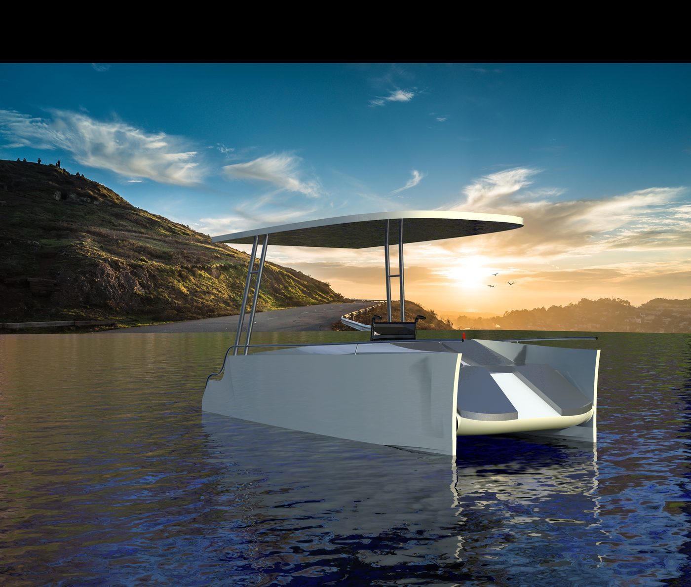
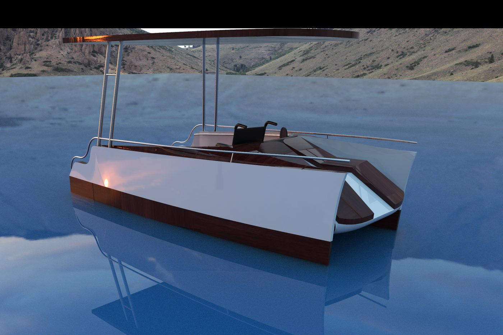
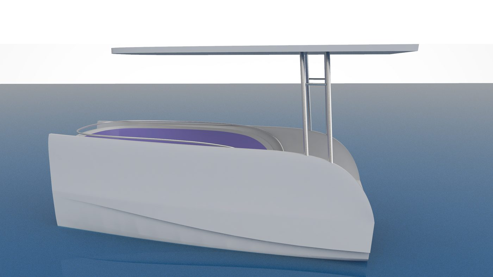
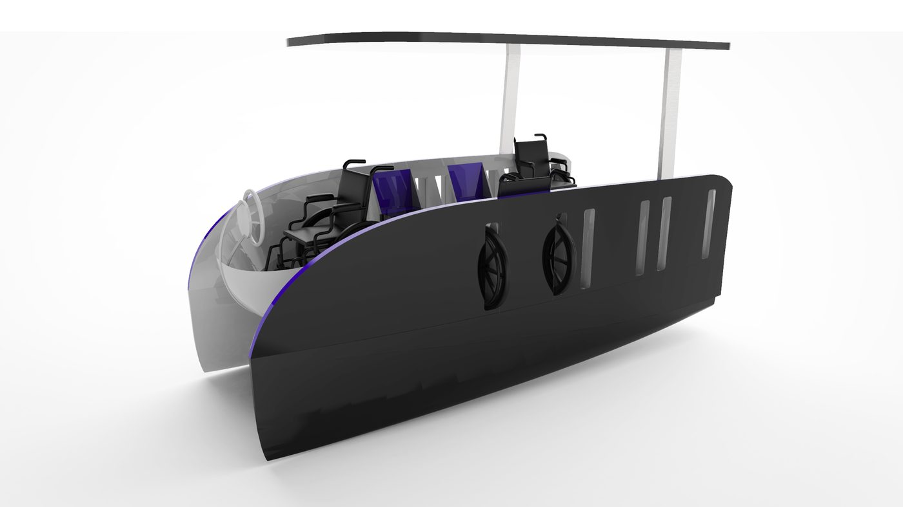
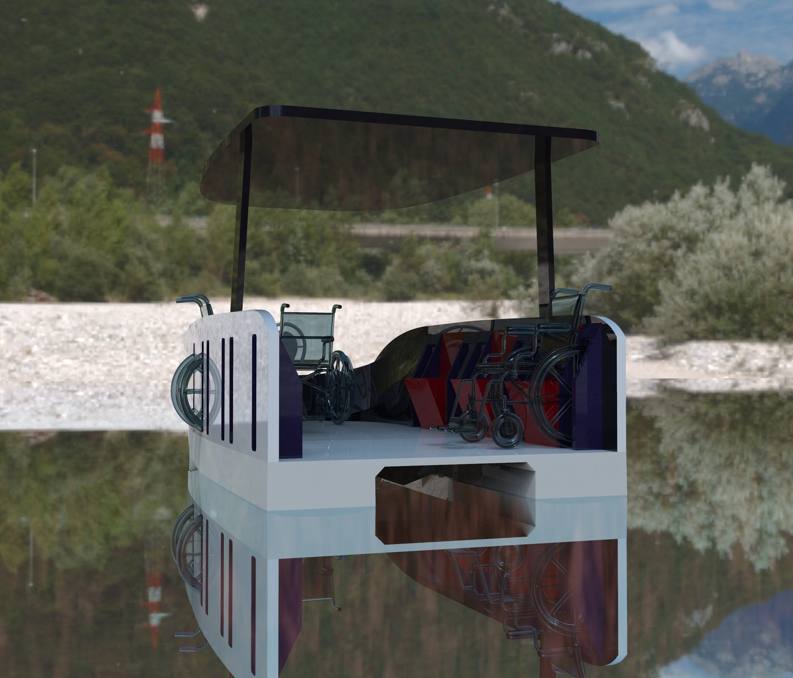
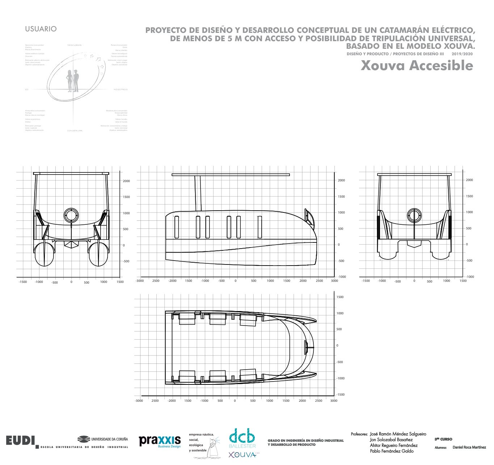
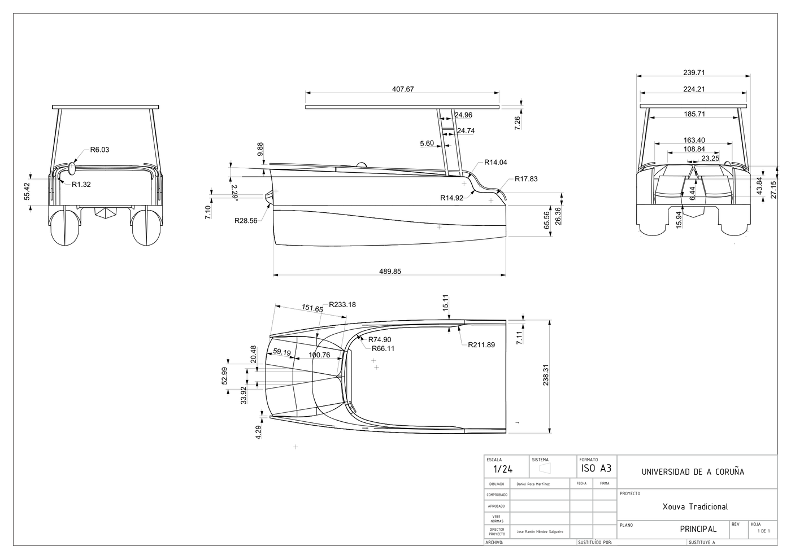

# Barco Xouva: proyecto final de 3.º

**Diseño y desarrollo conceptual de un catamarán eléctrico de menos de 5 m, con acceso y tripulación universal, basado en el modelo Xouva.**

Proyecto de *Diseño y Producto / Proyectos de Diseño III* (Grado en Ingeniería en Diseño Industrial y Desarrollo de Producto, EUDI, Universidade da Coruña, curso 2019/2020). Se hizo con empresas colaboradoras del sector náutico. El Xouva es un barco pequeño de una empresa náutica social, ecológica y sostenible.

## El reto

El punto de partida era el Xouva real, que visitamos y en el que subimos, y una visita a una asociación de personas con discapacidad. El encargo pedía:

- que el barco admitiera **hasta 7 personas en silla de ruedas**;
- que **cualquiera pudiera pilotarlo**, también desde una silla;
- mantener el casco de catamarán eléctrico y menos de 5 m de eslora.

De la visita saqué tres observaciones que guiaron todo el diseño:
- el barco **se mueve mucho** con varias personas encima;
- la proa **no está pensada para mucha carga**;
- el sitio fijo «para la silla» del modelo original **aparta** a quien la usa del resto del grupo.

## Tres propuestas, tres usuarios

| Propuesta | Para quién | Idea clave |
|---|---|---|
| **Xouva Tradicional** | Quien quiere lucir el barco y la estética clásica del lujo náutico | Madera, líneas de yate, **asientos plegables** que salen de la pared y **dos tumbonas en proa** que se reclinan al navegar |
| **Xouva Cómodo** | Un grupo de amigos que alquila el barco una tarde | Un gran **sofá curvo y plegable por tramos** del ancho de una silla de ruedas: cada persona se sienta donde quiera |
| **Xouva Accesible** | Las 7 personas en silla, como protagonistas y no como añadido | **Pared modular** que hace de asiento y **ranuras laterales** para encajar las ruedas sin quitarlas, mirando hacia dentro |

### El detalle del Xouva Accesible

- **Asientos abatibles como los de un cine**, pero con geometría triangular: cerrados, forman parte de la pared y no parecen un añadido.
- **Ranuras en los laterales** con un tope a la altura del eje. La silla se acerca al borde sin quitar las ruedas y su ocupante queda mirando al grupo. Como en la popa del Xouva original, el agua pasa tangencialmente y no entra.
- **Timón en el centro**, con el radio necesario para que la silla más grande gire sobre sí misma.
- La proa queda reservada para el peso de una sola persona con su silla, fuera de la zona de riesgo.

## Proceso y herramientas

1. **Fase de información**: mercado, competencia, normativa, materiales y proceso productivo, en grupo.
2. **Bocetos** a mano y digitales, y descarte de ideas.
3. **Modelado 3D** en *Rhinoceros* y *SolidWorks*, con varias iteraciones por propuesta.
4. **Renders** en *KeyShot*, con variaciones de materiales y escenarios.
5. **Planos acotados** y **paneles en retícula** (*Illustrator* / *InDesign*) para la presentación.

## Lo que me llevo

Diseñar **con** las personas usuarias y no solo para ellas: las mejores ideas, como las ranuras para las ruedas, salieron de observar el barco real y escuchar a la asociación.

---

Daniel Roca Martínez · [Currículum](https://daniroca5.gamer.gd/cv/) · [LinkedIn](https://www.linkedin.com/in/daniel-r-m-02b369164/)
