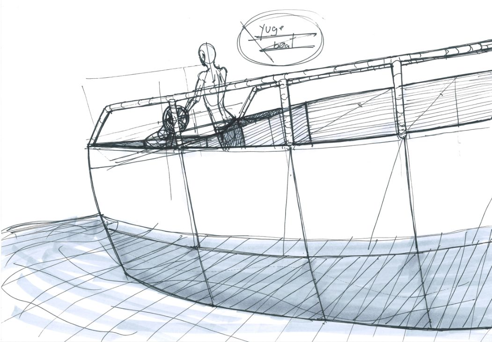
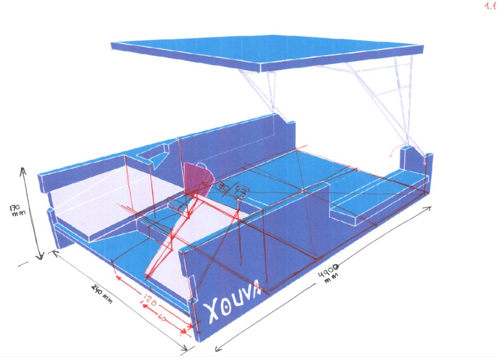
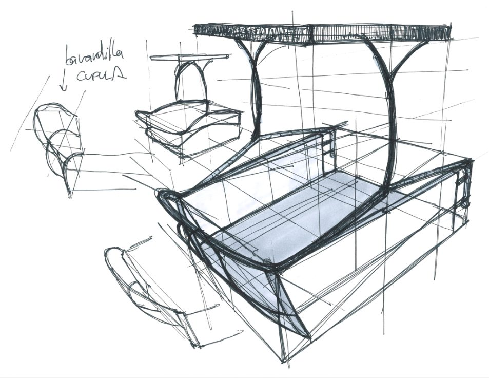
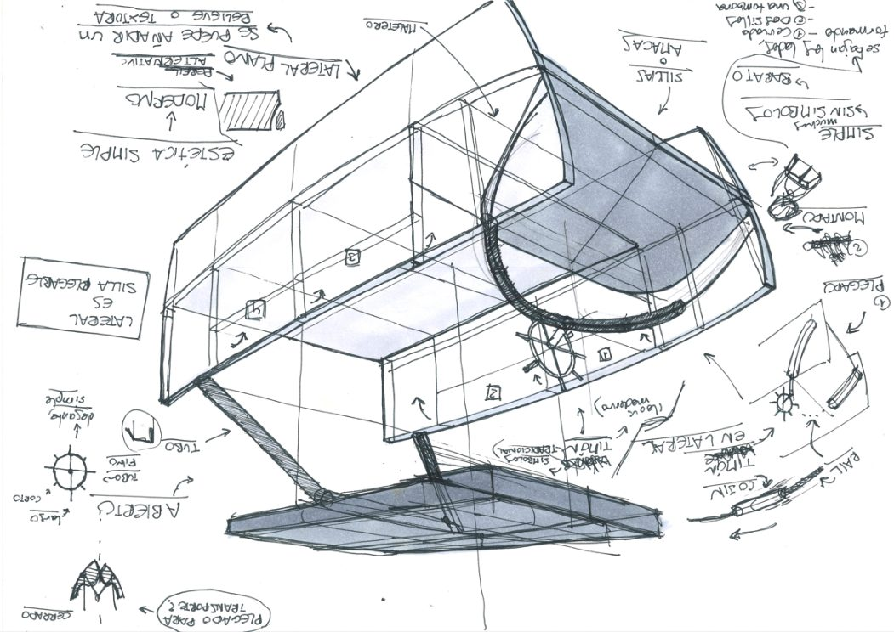
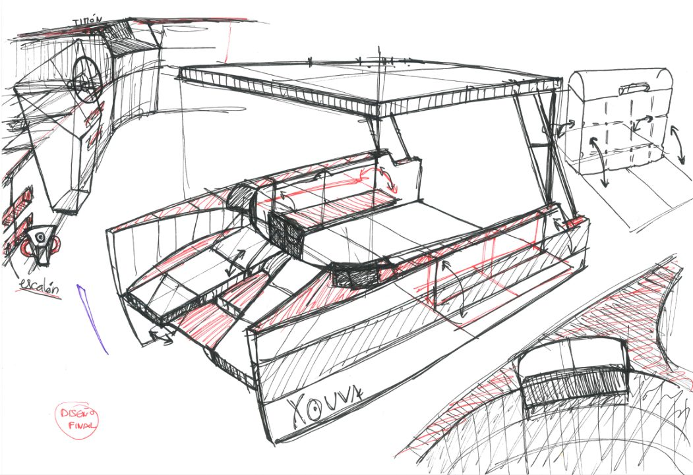
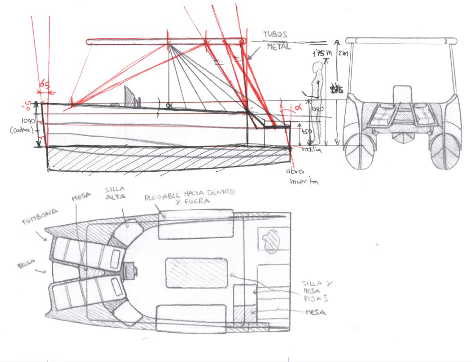

# Barco Xouva

Proyecto final de 3.º de Diseño Industrial (EUDI, Universidade da Coruña, 2019/2020): rediseñar el **Xouva**, un catamarán eléctrico de menos de 5 m, para que cualquiera pueda ir a bordo y pilotarlo, también en silla de ruedas.

## Tres propuestas
- **Tradicional**: madera, asientos plegables y tumbonas en proa.
- **Cómodo**: un sofá curvo que se pliega por tramos.
- **Accesible**: para 7 sillas de ruedas, con ranuras laterales para encajar las ruedas y el timón en el centro.

  

## Bocetos
Del lápiz al rotulador: volúmenes, el piloto en silla, el toldo y medidas.

 

  

## Planos y paneles
Modelado en Rhino y SolidWorks, renders en KeyShot, y paneles y planos en Illustrator e InDesign.

  

Más: [otros proyectos de la uni](https://github.com/daniroca5/otros-proyectos-diseno) · [modelado 3D](https://github.com/daniroca5/modelado-3d-cae)

---
Daniel Roca Martínez · [Currículum](https://daniroca5.gamer.gd/cv/)
